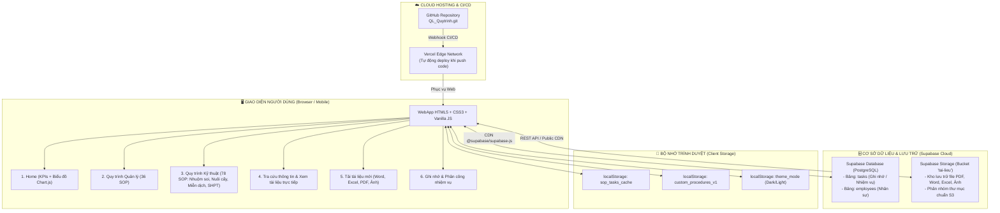
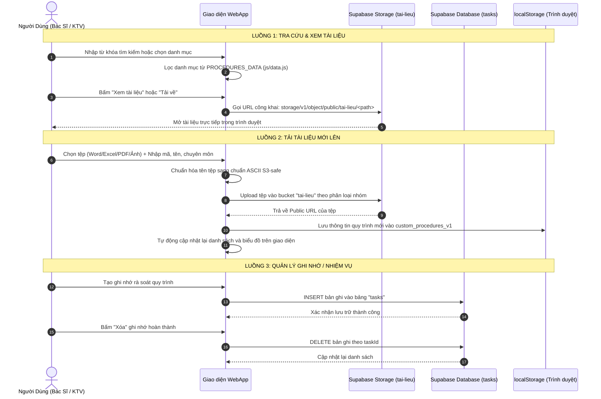

# 📘 BÁO CÁO TỔNG HỢP KIẾN TRÚC & MÔ HÌNH VẬN HÀNH HỆ THỐNG
## WebApp Quản Lý Quy Trình Xét Nghiệm Vi Sinh — Bệnh Viện Đa Khoa Đức Giang

---

## 1. Sơ Đồ Tổng Quan Kiến Trúc (End-to-End Architecture)

Hệ thống hoạt động theo mô hình **Serverless + Cloud Native**, không cần máy chủ backend trung gian (Node.js/Python server), chạy hoàn toàn bằng **HTML/CSS/JS thuần** kết hợp các dịch vụ đám mây chuyên dụng:

---

## 2. Chi Tiết Các Thành Phần Vận Hành

### 2.1. Giao Diện WebApp (Frontend)
- **Công nghệ nền tảng:** HTML5, CSS3, JavaScript thuần (ES6+), Chart.js (vẽ biểu đồ), Font Awesome (biểu tượng).
- **Thiết kế màu sắc:** Tông màu chủ đạo **Xanh Da Trời (Sky Blue)** đặc trưng ngành y tế, hỗ trợ chế độ Giao diện Sáng (Light Mode) và Tối (Dark Mode).
- **Cấu trúc Menu Trái (Sidebar Navigation):**
  1. 🏠 **Home:** Thống kê 4 khối KPI số liệu (Tổng số 114 quy trình, 36 quy trình quản lý, 78 quy trình kỹ thuật, số lượng nhiệm vụ) và 2 biểu đồ phân tích trực quan.
  2. 📂 **Quy trình quản lý:** Bộ lọc chuyên sâu 36 quy trình khối quản lý chất lượng (XN.QL).
  3. 🔬 **Quy trình kỹ thuật:** Phân nhóm 4 phân khoa chuyên môn:
     - *QT Nhuộm soi* (14 quy trình)
     - *QT Nuôi cấy* (28 quy trình)
     - *QT Miễn dịch* (20 quy trình)
     - *QT Sinh học phân tử* (16 quy trình)
  4. 🔍 **Tìm kiếm thông tin:** Hộp tìm kiếm toàn văn thông minh (bỏ dấu tiếng Việt, tìm theo mã số, tên quy trình, năm ban hành, từ khóa).
  5. 📤 **Tải tài liệu mới:** Nút mở cửa sổ tải tệp nhanh lên kho đám mây.

---

### 2.2. Nơi Lưu Trữ Code (Source Code Management)
- **Đường dẫn Repository:** [https://github.com/bsdaoquangtrungducgiang-ai/QL_Quytrinh.git](https://github.com/bsdaoquangtrungducgiang-ai/QL_Quytrinh.git)
- **Nhánh chính:** `main`
- **Cơ chế tự động hóa:**
  - Script [auto_push.sh](file:///Users/user/Downloads/3.%20QL_Quy_Trinh/auto_push.sh) tự động gắn token GitHub PAT, đóng gói commit và đẩy code lên GitHub mỗi khi có thay đổi trong dự án.
  - Không cần nhập mật khẩu thủ công.

---

### 2.3. Cơ Chế Hosting Trên Vercel (Deployment)
- **Nền tảng:** Vercel Global Edge Network.
- **Liên kết CI/CD:** Vercel được kết nối trực tiếp với GitHub Repository `QL_Quytrinh.git`.
- **Luồng hoạt động:**
  1. Mỗi khi lệnh `git push origin main` thành công, GitHub gửi tín hiệu Webhook sang Vercel.
  2. Vercel tự động kích hoạt tiến trình Build & Deploy bản mới trong vòng 10–30 giây.
  3. Tệp cấu hình [vercel.json](file:///Users/user/Downloads/3.%20QL_Quy_Trinh/vercel.json) bảo đảm các đường dẫn tài liệu và route tĩnh được phân phối với tốc độ cao và nén dữ liệu tự động.

---

### 2.4. Nơi Lưu Trữ Dữ Liệu (Data Layer trên Supabase)
Dự án sử dụng cơ sở hạ tầng đám mây của **Supabase** (Project ID: `wbzjkwudiaeisujoimfi`, khu vực Châu Á):

| Loại dữ liệu | Nơi lưu trữ thực tế | Cơ chế hoạt động & Định dạng |
| :--- | :--- | :--- |
| **Kho tệp số hóa** | Supabase Storage Bucket `tai-lieu` | Lưu trữ toàn bộ 114 tệp SOP gốc và các tệp mới tải lên (PDF, Word, Excel, Ảnh). |
| **CSDL Quản lý tệp** | Supabase PostgreSQL Table `documents` | Lưu thông tin chi tiết từng tệp: Mã quy trình, tên, nhóm chuyên môn, định dạng, dung lượng, đường dẫn Storage (`storage_key`), ngày cập nhật. |
| **Bộ đệm Offline** | Trình duyệt `localStorage` | Giúp ứng dụng vẫn xem và tra cứu được dữ liệu ngay cả khi mất mạng internet. |

---

## 3. Quy Trình Xử Lý, Tải Lên & Xóa Dữ Liệu

### 3.1. Chuẩn Hóa Tên Tệp & Thư Mục (ASCII S3-Safe)
Để chống lỗi `InvalidKey` do ký tự tiếng Việt có dấu tổ hợp (NFD trên macOS), hệ thống sử dụng thuật toán chuẩn hóa:
- **Nguyên tắc:** Loại bỏ dấu tiếng Việt, thay thế khoảng trắng và ký tự đặc biệt bằng dấu gạch dưới (`_`), giữ lại dấu chấm mở rộng.
- **Ví dụ phân nhóm:**
  - `Quản Lý Chất Lượng/XN.QL.01.03.File PDF...` ➔ `Quan_Ly_Chat_Luong/XN.QL.01.03.File_PDF...`
  - `Nhuộm Soi/VS.NS.01.02...` ➔ `Nhuom_Soi/VS.NS.01.02...`
  - `Nuôi cấy` ➔ `Nuoi_cay`
  - `Miễn dịch` ➔ `Mien_dich`
  - `Sinh học PT` ➔ `Sinh_hoc_PT`

### 3.2. Cơ Chế Xóa Dữ Liệu
- **Xóa Ghi nhớ / Nhiệm vụ quy trình:**
  - Khi người dùng bấm biểu tượng thùng rác 🗑️ tại danh sách nhiệm vụ, hệ thống gửi lệnh `DELETE FROM tasks WHERE id = taskId` trực tiếp lên Supabase.
  - Đồng thời xóa bản ghi khỏi bộ đệm `localStorage` của trình duyệt.
- **Bảo toàn Tài liệu Quy trình:**
  - 114 tài liệu SOP gốc được thiết lập ở trạng thái cố định (Read-Only) để tránh rủi ro bị xóa nhầm bởi người dùng thông thường, đảm bảo an toàn tuyệt đối cho hồ sơ lưu trữ quản lý chất lượng bệnh viện.

---

## 4. Tổng Kết Bảng Phân Quyền & Bảo Mật (RLS Policies)

| Đối tượng | Quyền Xem (SELECT) | Quyền Tải Lên (INSERT) | Quyền Sửa (UPDATE) | Quyền Xóa (DELETE) |
| :--- | :---: | :---: | :---: | :---: |
| **Bucket `tai-lieu`** | ✅ Mọi người (Public) | ✅ Cán bộ khoa (Policy) | ✅ Quản trị viên | 🔒 Khóa (Bảo vệ SOP gốc) |
| **Bảng `tasks`** | ✅ Cán bộ khoa | ✅ Cán bộ khoa | ✅ Người phụ trách | ✅ Người tạo / Quản trị |
| **Mã nguồn GitHub** | 🔒 Private / Token PAT | 🔒 Chỉ đẩy qua auto_push | 🔒 Chỉ commit hợp lệ | 🔒 Bảo vệ nhánh main |
